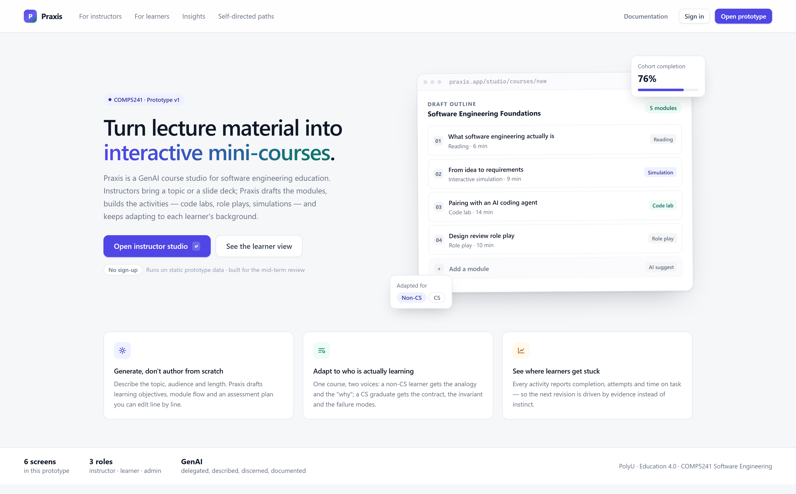

# Praxis — a GenAI course studio for software engineering education

**COMP5241 Software Engineering · Group project · Semester 1 2026/27**

Praxis turns lecture material into interactive mini-courses. An instructor brings a slide deck or a
one-paragraph brief; Praxis drafts the module sequence, builds the activities (code labs, role plays,
stakeholder simulations), and adapts the wording to each learner's background. Learners get a path,
not a playlist — they can also generate their own.

> **Status: the platform runs end to end.**
> A deck or a brief goes in at `/studio`, a course comes out, learners play it at
> `/learn`, and every click writes an `Event` that `/insights` and the course
> editor read back. Progress, attempts, cohort tables, CSV export and version
> diffs are queries over that log — none of them are fixtures. Roles are enforced
> on the server (`requireStaff` / `requireRole`), not in the sidebar.
>
> Two activity formats are modelled but not built: mini-games and narrated
> slides. The screens say so instead of showing an empty card. Language switching
> is English-only for the same reason — it is stated, not implied.
>
> The mid-term prototype is untouched in [`prototype/`](prototype) and remains
> the visual reference for every screen.



---

## Quick start

```bash
npm install
# one-time: put DATABASE_URL + DATABASE_URL_UNPOOLED in .env.local
#   (neon init && neon login && neon deploy does it for you)
npm run db:push      # create the tables
npm run db:seed      # load the prototype fixture data
npm run dev          # http://localhost:3000
```

Data lives in a Neon Postgres branch. You land as **Dr. R. Kwok** (instructor);
`/login` switches role — pick **A. Tse** to see the admin console.

| Route | What it is | Owner |
| --- | --- | --- |
| `/` | landing | R1 |
| `/studio` | **upload a deck, get a course** — audience, length, generation log | R4 |
| `/courses` | course list | R3 |
| `/courses/[id]` | **course editor** — modules, activities, ordering, publishing, versions, cohort stats, roster import, CSV export | R3 |
| `/courses/[id]/versions` | version diff, only where a snapshot was written | R3 |
| `/learn` | **learner runtime** — eight activity formats, hints, tutor, checkpoints | R2 |
| `/insights` | cohort analytics over the event log | R4 |
| `/path` | self-directed path builder | R5 |
| `/admin` | **cohorts and teaching assignments** | R3 |
| `/login` | role switch | R3 |

The prototype is still directly openable and is the thing to change first if a
style needs to move:

```bash
python -m http.server 8080 --directory prototype
# then visit http://localhost:8080
```

Screens: `index.html` (landing) · `studio.html` (instructor authoring) · `course.html` (course &
cohort) · `learn.html` (learner code lab) · `analytics.html` (insights) · `path.html` (self-directed
path builder).

## Repository layout

```
app/                  Next.js App Router
  globals.css         the design system, copied verbatim from prototype/css/styles.css
  additions.css       components the prototype did not have (editor, admin, sign-in)
  courses/            list + editor, with server actions in actions.ts
  admin/              cohorts and teaching assignments
  studio|learn|insights|path/   routes that mount the ported prototype screens
components/
  Shell.tsx           sidebar + topbar, copied from prototype/course.html
  ported/             prototype screens converted to JSX by tools/html_to_tsx.py
  AutoSubmitInput.tsx inline fields that save their form on blur
  PrototypeScripts.tsx transitional: runs prototype/js/app.js behaviours app-wide
lib/
  types.ts            domain types, mirroring prisma/schema.prisma
  store.ts            data access — file-backed today, Prisma in week 10
  auth.ts             session + role guard
  format.ts           label/pill mapping
prisma/schema.prisma  target data model (cohorts, courses, modules, activities, events, ai_runs)
prototype/            the week 8 prototype — untouched, and the visual reference
docs/                 progress update, requirements, architecture, AI log, test plan, board guide
tools/                html_to_tsx.py (prototype → JSX), trim_screenshots.py
.github/              issue and PR templates, CI
```

## How the two versions stay in step

`prototype/` is the source of truth for the look. When a style has to change,
change it there and re-run the converter — never hand-edit a ported screen:

```bash
cp prototype/css/styles.css app/globals.css
python tools/html_to_tsx.py prototype/studio.html components/ported/Studio.tsx Studio
```

The converter copies markup verbatim and rewrites only what JSX requires. Screens
that R2, R4 and R5 own will be replaced by real components in weeks 9–10; the
generated files are a bridge, not the destination.

## What works in the prototype

| Interaction | Where |
| --- | --- |
| Generate a course outline from a brief, with a step-by-step generation log | `studio.html` → **Generate outline** |
| Switch audience (non-CS / CS / mixed) and session length | `studio.html` |
| Inspect modules, per-activity completion, version history | `course.html` |
| Toggle the AI tutor between plain / analogy / formal explanations | `learn.html` |
| Run tests in the code lab (2 → 3 passing, checkpoint unlocks) | `learn.html` |
| Reveal a staged hint | `learn.html` → **Ask for a hint** |
| Regenerate a four-week learning path | `path.html` → **Design my path** |

All data is seeded in the markup. There is no backend yet; this prototype exists to validate the
interaction model and the information architecture before we commit to an implementation.

## Team

Five workstreams, one per member. Each is a vertical slice of the product — one
person owns a feature from screen to data — rather than a horizontal layer.

| Workstream | Owns | Screens |
| --- | --- | --- |
| R1 演讲 | narrative, the pitch, the live demo | landing |
| R2 制片 | course player, code lab, hinting, activity state | `/learn` |
| R3 平台 | platform base, course editor, admin, deployment, testing | `/courses`, `/admin`, deploy + CI |
| R4 AI 与数据 | generation pipeline, prompt registry, analytics | `/studio`, `/insights` |
| R5 内容 | content, handbooks, peer-evaluation run | `/path` |

Names and student IDs are on the week 3 group-formation form.

## Documents

- [Deployment](DEPLOYMENT.md)
- [Test plan](docs/test-plan.md)
- [Working the board](docs/board.md)
- [Mid-term progress update](docs/midterm-update.md)
- [Requirement traceability](docs/requirements.md)
- [Architecture](docs/architecture.md)
- [AI usage log (4D)](docs/ai-usage-log.md)
