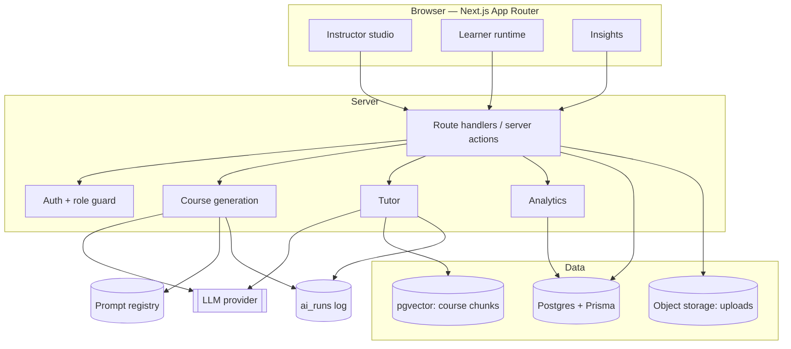
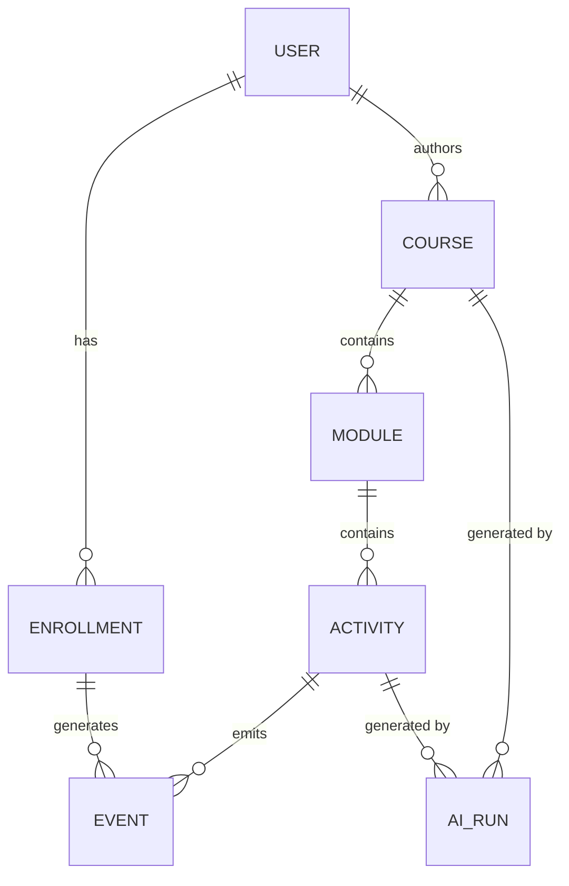

# Architecture

Status: **target design**, written during week 8. The prototype implements the information
architecture and interaction model only; nothing below is running yet except the screens.

## 1. Shape of the system

## 2. Stack decisions

| Decision | Choice | Why | Rejected |
| --- | --- | --- | --- |
| Framework | Next.js (App Router) + TypeScript | one deployable for UI + server logic; streaming responses are first-class | separate SPA + API (two deployments, more glue) |
| Styling | hand-written CSS design system, ported from the prototype | the prototype already is the design system; no rebuild cost | Tailwind (would restart the styling work) |
| Database | Postgres + Prisma | relational shape (courses → modules → activities → events) and easy hosting (Neon/Supabase) | Mongo (weak joins for analytics) |
| Auth | Clerk, fallback NextAuth | three roles, invitation flow, low build cost | custom auth (not the learning objective) |
| LLM access | one `lib/ai` module with a provider interface | prompt versions and cost logging live in one place | direct SDK calls scattered in routes |
| Vector search | pgvector inside the same Postgres | one database to operate at this scale | separate vector service |
| Code execution | Piston-compatible sandbox service | isolated, language-agnostic, no container orchestration | browser WebContainers (licensing, weaker server checks) |
| Deploy | Vercel | rubric names it; preview deployments per PR | university VM |

## 3. Data model (draft)

| Table | Key fields |
| --- | --- |
| `users` | id, email, name, role (`learner`/`instructor`/`admin`), background (`non_cs`/`cs`), locale |
| `courses` | id, title, brief, audience, minutes, status (`draft`/`review`/`published`), version, owner_id |
| `modules` | id, course_id, position, title, objective, estimated_minutes |
| `activities` | id, module_id, format (`reading`/`simulation`/`code_lab`/`role_play`/`quiz`/`game`/`narrated_slides`), payload JSONB, rubric JSONB |
| `enrollments` | id, course_id, user_id, imported_from, created_at |
| `events` | id, enrollment_id, activity_id, type (`view`/`attempt`/`hint`/`complete`), payload, created_at |
| `ai_runs` | id, purpose (`outline`/`activity`/`tutor`/`insight`), prompt_version, model, tokens_in, tokens_out, latency_ms, cost_usd, accepted_by, created_at |
| `prompt_versions` | id, purpose, version, template, changelog, created_at |

`events` is append-only. Analytics reads it; nothing mutates it. This keeps the evidence honest and
makes "why did completion drop" answerable after the fact.

## 4. The generation pipeline

1. **Ingest** — accept PDF/MD/PPTX; extract text per page; store chunks in `pgvector` with page refs.
2. **Plan** — one call produces learning outcomes and a module skeleton constrained by audience and
   time budget. Output is JSON, validated against a schema; a failed validation retries once with the
   error appended, then surfaces to the instructor.
3. **Expand** — per-module call produces the activity payload (task, starter code, tests, rubric,
   hint ladder). Module-by-module keeps latency tolerable and lets a failure be retried locally.
4. **Check** — deterministic pedagogy rules (objective coverage, prerequisite order, activity mix,
   accessibility fields) plus a model-based gap check. Results render as the checklist in the studio.
5. **Gate** — nothing publishes without instructor approval. Approval is recorded on `ai_runs`.

Tutor answers use the same chunk store with a strict system prompt: answer only from retrieved
chunks, cite the chunk, and say "not in the course material" otherwise. Refusals are logged, because
a refusal rate is a useful health metric for the course, not an error.

## 5. Service boundaries

| Module | Responsibility | Owner |
| --- | --- | --- |
| `lib/ai` | provider interface, prompt rendering, retries, cost logging | Member A |
| `lib/course` | generation pipeline, schema validation, pedagogy checks | Member A |
| `app/learn` | activity runtime, attempt state, hint policy, sandbox calls | Member B |
| `app/studio`, `app/courses` | authoring, versions, publishing, cohort import | Member C |
| `app/insights`, `lib/analytics` | event rollups, at-risk detection, insight generation | Member C |
| `lib/ui`, `app/layout` | design system, shell, auth guard, deployment | Member D |

## 6. Non-functional targets

- First outline token within 1.5 s; full 5-module draft under 20 s (streamed, module by module).
- Course pages server-rendered; learner interactions optimistic, with event writes batched.
- Every prompt change is a new `prompt_version` row with a changelog line — no silent edits.
- Cost ceiling: a generated 45-minute course must stay under US$0.30 in model spend.

## 7. What we are deliberately not doing

- No mobile app; the runtime is responsive web.
- No real-time collaboration on a draft (conflict handling is not worth the weeks).
- No custom LLM fine-tuning; prompt + retrieval quality first.
- No admin analytics beyond cohort creation in this iteration.
