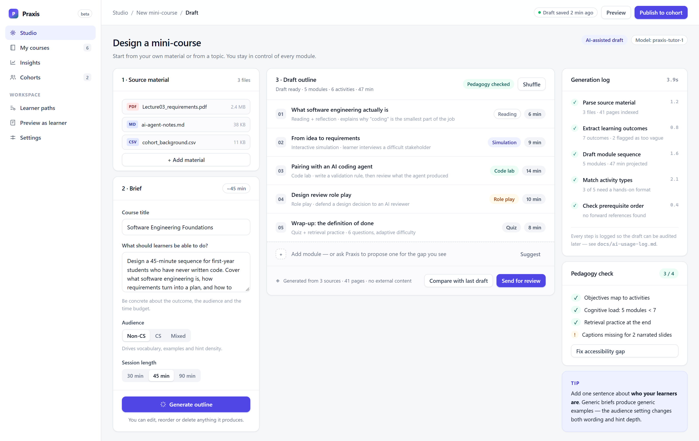
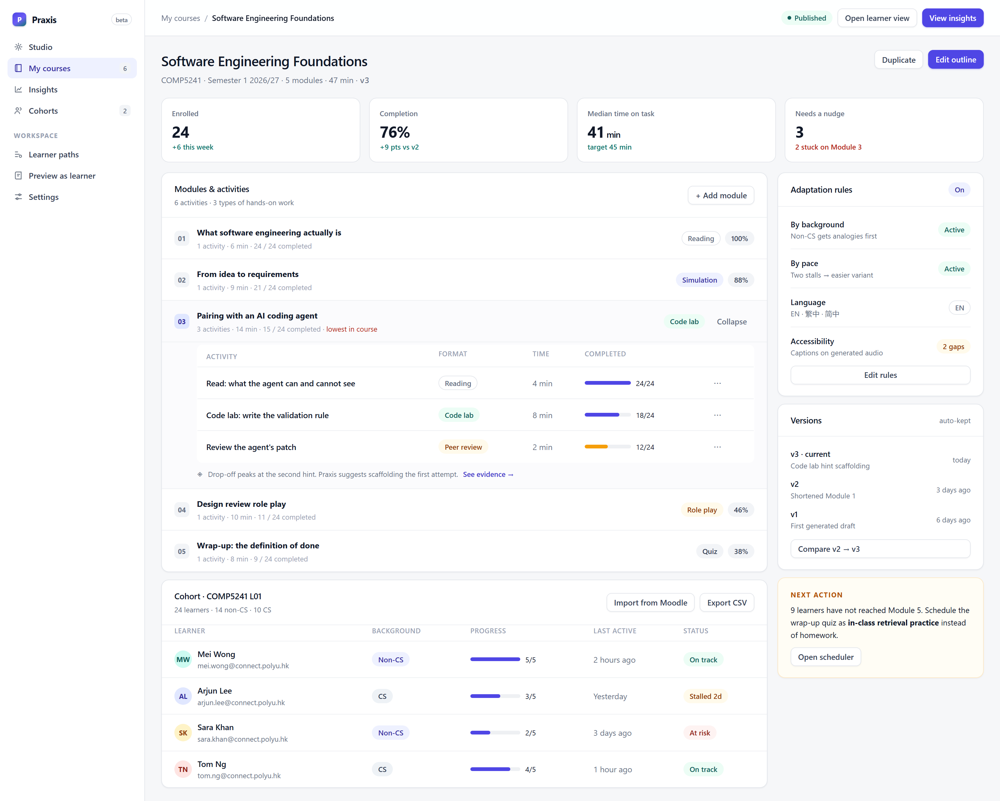
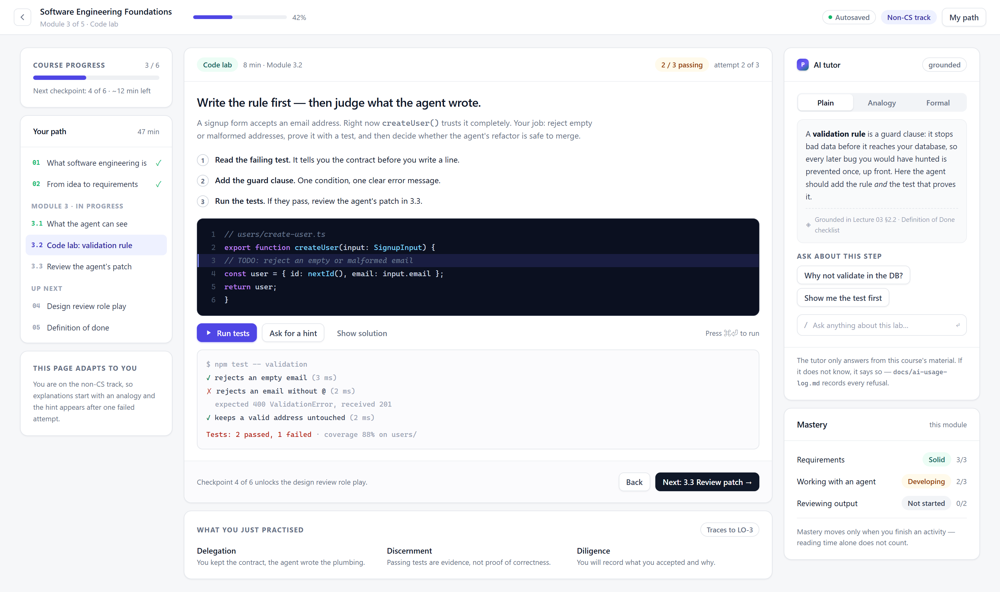
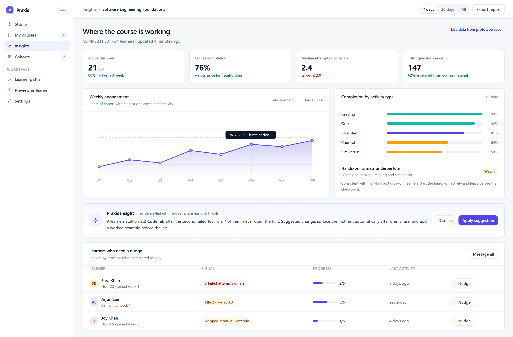
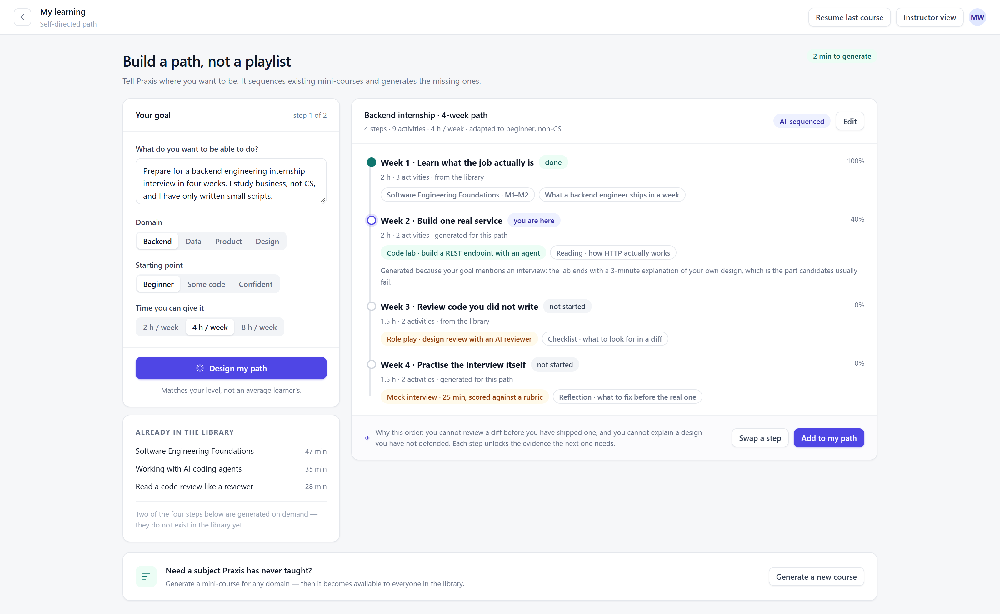
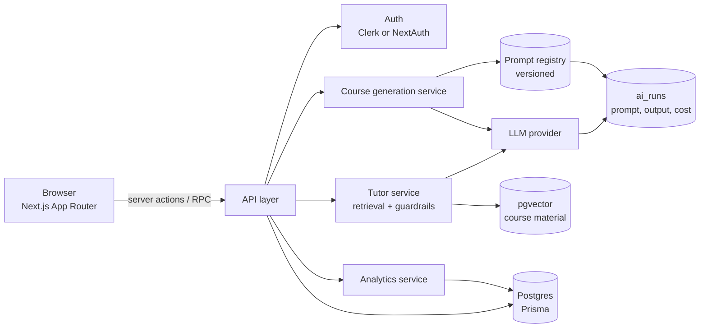

# Mid-term progress update — Praxis

**Course:** COMP5241 Software Engineering · Semester 1 2026/27
**Group:** _Group number_ · 4 members
**Repository:** <https://github.com/Rjiang12138/comp5241-project1>
**Date:** 20 October 2026 · submitted before 21 October 2026, 12:00

---

## 1. In one paragraph

We are building **Praxis**, a GenAI course studio that turns lecture material into interactive
mini-courses. The instructor brings a slide deck or a short brief; Praxis drafts the module sequence,
builds the activities — code labs, stakeholder simulations, role plays — and adapts the wording and
hint depth to each learner's background. Learners get a sequenced path rather than a playlist, and
instructors get evidence about where the cohort actually stalls.

At this milestone the **interaction model and information architecture are settled and clickable**:
six screens, a shared design system, and the generation/adaptation loop demonstrated end to end. The
implementation behind them is still mocked. Weeks 9–11 replace the mock data with a real Next.js
application, a Postgres schema, and a grounded LLM pipeline.

## 2. Why this project, and how it differs

The brief asks for mini-courses that teach software engineering *and* the craft of working with AI
coding agents, for learners with very different starting points. Two observations shaped our design.

First, **generation is now cheap but judgement is not**. A learner who can produce a working
prototype in an afternoon needs practice at framing requirements, reviewing generated code, and
deciding what not to delegate — not another video lecture.

Second, **the same content cannot serve a business student and a CS graduate**. A single course with
one fixed voice will either lose the first group or bore the second. Adaptation has to be a
first-class feature, not a settings page.

| Existing tool | What it does well | The gap we target |
| --- | --- | --- |
| GPTutor (PolyU) | grounded Q&A over course material | Q&A only — no authoring, no activities, no cohort view |
| EvoClass | live classroom interaction and response data | synchronous; no async mini-courses, no generation |
| Teach me now / Start.dev | fast AI-generated lessons | one-size content, little instructor control, no evidence loop |
| **Praxis** | — | instructor-controlled generation + activity formats that force practice + adaptation + a feedback loop from evidence |

Our differentiator is the **closed loop**: generate → learners practise → evidence of where they
stall → revise the course. Most tools stop at generation.

## 3. What exists today

| Area | Status | Where |
| --- | --- | --- |
| Design system (tokens, components, layout) | done | `prototype/css/styles.css` |
| Instructor authoring flow | done (mock) | `studio.html` |
| Course & cohort management | done (mock) | `course.html` |
| Learner runtime with code lab and adaptive tutor | done (mock) | `learn.html` |
| Cohort analytics and intervention prompt | done (mock) | `analytics.html` |
| Self-directed path builder | done (mock) | `path.html` |
| Data model | drafted | `docs/architecture.md` |
| Backend, auth, real LLM calls, deployment | **not started** | week 9–11 |

Everything runs from the file system with no build step and no network access, so the prototype can
be reviewed without installing anything.

## 4. The prototype

### 4.1 Landing — the pitch in one screen


*Six screens, three roles. The screenshot strip is the entry point reviewers will see first, so the
value proposition had to be legible in five seconds.*

### 4.2 Instructor studio — brief in, editable draft out



The instructor supplies material, a concrete learning outcome, an audience and a time budget. The
generation runs as a **visible, auditable sequence** (parse → extract outcomes → draft sequence →
match activity types → check prerequisite order) rather than a spinner. Every step is logged, which
serves two purposes: the instructor can see *why* a module exists, and we can debug a bad draft.

The audience control is not cosmetic. It changes vocabulary, example domain and hint density — the
difference between "think of a bouncer at a door" and "specify the precondition contract".

The pedagogy panel deliberately reports **3 of 4**: generated drafts fail in predictable ways, and an
unchecked checklist would train instructors to ignore it. Here it flags missing captions on two
narrated slides and offers a one-click fix.

### 4.3 Course and cohort — where customisation becomes concrete



Modules expand into activities with per-activity completion. The lowest-performing activity is
labelled in place, next to the action that fixes it. The right column holds the adaptation rules
(background, pace, language, accessibility), version history, and a single next action.

Two decisions worth flagging:

- **Versions are kept automatically.** Instructors rewrite courses constantly; without history they
  cannot compare a change against the evidence that motivated it.
- **Cohort import is explicit** (Moodle / CSV). Asking instructors to re-enter a class list is the
  fastest way to lose them.

### 4.4 Learner runtime — the code lab



This is the screen we spent the most time on. The learner writes a validation rule, runs tests
(2 of 3 pass on the first attempt, by design), asks for a hint if needed, and then reviews a patch the
agent produced. The AI tutor answers in one of three registers — plain, analogy, formal — and shows
its source. The bottom strip names the competency being practised (delegation, discernment,
diligence), so the learner can see the point of the exercise.

The hint is **staged**: it appears after one failed attempt rather than on demand, because our first
wireframe let learners skip straight to the answer.

### 4.5 Insights — evidence, then one action



Completion by activity type exposed a real pattern in the mock data: reading and quizzes finish;
simulations and code labs do not. The insight card ties that to the specific activity, quantifies it
(nine learners, second failed attempt, 7 of 9 never open the hint) and proposes one change. We
deliberately avoided a dashboard that reports everything and recommends nothing.

### 4.6 Self-directed paths — learning beyond the course



Learners state a goal ("backend internship interview in four weeks"), a starting point and a weekly
time budget. Praxis sequences existing mini-courses and **generates the missing ones**, showing which
steps came from the library and which were created on demand. This satisfies the brief's requirement
that learners build their own topics and paths, and that the platform can generate courses for
domains it has never taught.

## 5. Requirement traceability

| Brief requirement | Covered by | Note |
| --- | --- | --- |
| Mini-courses with interactive content and activities | learner runtime, course editor | |
| Topics: SE fundamentals, AI coding agents, soft/product skills | generated outline | soft skills appear as the design-review role play |
| Formats: text/images, simulations, role play, games, AI-narrated slides, online coding | activity type taxonomy | games and narrated slides are specified, not yet built |
| Content accessible to non-CS majors *and* useful to CS graduates | audience switching, three tutor registers | the core adaptation claim |
| Instructors customise content manually or with AI | studio, course editor | |
| Instructors generate new courses from their own topics/materials | studio | |
| Import students, track participation and engagement | cohort table, insights | import is a UI mock; Moodle integration planned |
| Generate courses for other subjects/domains | self-directed path page | |
| Learners generate their own topics and paths | self-directed path builder | |
| Multiple prototypes, one integrated final app | two rounds so far | round 2 is the prototype in this repo |
| Each member contributes visibly | division of work below | enforced through issues and PRs |

## 6. Planned architecture



Two rules we are carrying into the build:

1. **Every model call is recorded** — prompt version, inputs, output, latency, cost, and whether an
   instructor accepted it. Without this we cannot evaluate a prompt change, and we cannot answer the
   AI Fluency questions honestly.
2. **Generation is grounded and gated.** Drafts are produced only from uploaded material plus the
   instructor's brief, every claim links to a source chunk, and nothing reaches learners without an
   explicit instructor approval step.

Core entities: `users` (learner / instructor / admin), `courses`, `modules`, `activities`
(format, payload, rubric), `enrollments`, `events` (view, attempt, completion), `ai_runs`,
`prompt_versions`.

## 7. Division of work

| Member | Primary responsibility | Visible artefacts |
| --- | --- | --- |
| _Member A — name / ID_ | Product framing, AI pipeline, prompt registry, evaluation | `docs/ai-usage-log.md`, generation service |
| _Member B — name / ID_ | Learning runtime: player, code lab, hinting, activity state | `learn.html` → Next.js runtime |
| _Member C — name / ID_ | Instructor surface: editor, cohorts, analytics | `studio.html`, `course.html`, `analytics.html` |
| _Member D — name / ID_ | Platform: design system, auth, deployment, CI | `styles.css`, deployment pipeline |

Shared: requirement interviews, prototype reviews, documentation, slides.

> Replace the four placeholder rows with real names and student IDs before submitting.

## 8. How we work with AI

We use coding agents for scaffolding, test generation, refactoring and copy editing, and keep
architecture, data modelling and review decisions human. The full log — with prompts, rejections and
the reasoning — is in [`ai-usage-log.md`](ai-usage-log.md). Summary against Anthropic's 4D framework:

| | What it means for us | Current practice |
| --- | --- | --- |
| **Delegation** | deciding what to hand over | agents own boilerplate, fixtures, CSS scaffolding; humans own schema, API contracts, security, and every merge |
| **Description** | specifying goals, constraints, process | prompts live in `docs/ai-usage-log.md` and are versioned like code; each names the files, the constraint and the definition of done |
| **Discernment** | evaluating output | every generated diff is read line by line; we keep examples of what we rejected and why |
| **Diligence** | verifying, documenting, owning | tests before merge, `ai_runs` logging, and a rule that nobody presents code they cannot explain |

## 9. Problem areas and how we are handling them

| Risk | Impact | Mitigation |
| --- | --- | --- |
| Generated courses feel generic | the product's main claim collapses | grounding in uploaded material + instructor approval gate + audience-specific registers |
| LLM latency makes authoring feel slow | instructors abandon the draft | stream the outline, generate module-by-module, cache prompt prefixes |
| Scope: three roles, five activity types | nothing is finished | admin is deprioritised to week 11; two activity types (code lab, role play) are built properly first |
| Evidence is thin at presentation time | rubric penalises unverified claims | seed a real cohort of classmates in week 10 and report their actual usage, not invented numbers |
| Team availability around other coursework | late integration | weekly branch merges; no feature is "done" until it is merged and deployed |

## 10. Plan to the final submission

| Week | Focus | Exit criterion |
| --- | --- | --- |
| 9 | Next.js skeleton, auth, schema, course generation service | an instructor can generate and save a real course |
| 10 | Learner runtime with real attempts, hinting, code execution sandbox | one course playable end to end by a classmate |
| 11 | Analytics, seed cohort, deploy, report, manual, demo video | public URL + recording + report complete |
| 12–13 | Slides, rehearsal, peer review | 8-minute talk, 5-minute Q&A |

## 11. Reviewing the prototype

```bash
python -m http.server 8080 --directory prototype
# http://localhost:8080
```

or open `prototype/index.html` directly. Screens are also captured at 2× in
[`docs/screenshots/`](screenshots).
